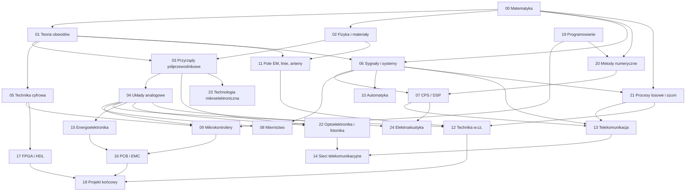

# Roadmapa — kolejność, zależności i czas

## Graf zależności

## Proponowany układ „semestralny”

Odpowiada typowemu 7-semestralnemu programowi inżynierskiemu EiT. Kolejność wewnątrz semestru można zmieniać.

| Semestr | Moduły | Uwagi |
|---|---|---|
| 1 | 00 Matematyka (część 1), 02 Fizyka (mechanika, elektrostatyka), 01 Teoria obwodów (prąd stały), 19 Programowanie (Python, podstawy C) | Fundament — nie skracaj |
| 2 | 00 Matematyka (część 2), 01 Teoria obwodów (AC, stany nieustalone), 05 Technika cyfrowa (kombinacyjna), 19 Programowanie (C, struktury danych, git) | Liczby zespolone muszą być „w palcach” |
| 3 | 03 Przyrządy półprzewodnikowe, 05 Technika cyfrowa (sekwencyjna), 06 Sygnały i systemy (czas ciągły), 20 Metody numeryczne | |
| 4 | 04 Układy analogowe, 06 Sygnały i systemy (czas dyskretny), 11 Pole EM, 23 Technologia mikroelektroniczna | Najtrudniejszy semestr |
| 5 | 07 CPS/DSP, 08 Miernictwo, 09 Mikrokontrolery, 10 Automatyka, 21 Procesy losowe i szum | Dużo praktyki |
| 6 | 12 Technika w.cz., 13 Telekomunikacja, 15 Energoelektronika, 17 FPGA, 22 Optoelektronika i fotonika | Wybór specjalizacji |
| 7 | 14 Sieci, 16 PCB i EMC, 18 Projekt końcowy, 24 Elektroakustyka (obieralny) | |

## Szacowany nakład pracy

Szacunki dla osoby uczącej się od zera. Przy odświeżaniu wiedzy po studiach liczy się zwykle 40–60% tego czasu.

| Moduł | Godziny |
|---|---|
| 00 Matematyka | 120–200 |
| 01 Teoria obwodów | 100–150 |
| 02 Fizyka i materiały | 60–100 |
| 03 Przyrządy półprzewodnikowe | 50–80 |
| 04 Układy analogowe | 100–150 |
| 05 Technika cyfrowa | 60–90 |
| 06 Sygnały i systemy | 80–120 |
| 07 CPS/DSP | 60–90 |
| 08 Miernictwo | 40–60 |
| 09 Mikrokontrolery | 60–100 |
| 10 Automatyka | 40–60 |
| 11 Pole EM, linie, anteny | 70–100 |
| 12 Technika w.cz. | 50–80 |
| 13 Telekomunikacja | 60–90 |
| 14 Sieci telekomunikacyjne | 40–60 |
| 15 Energoelektronika | 40–60 |
| 16 PCB i EMC | 40–60 |
| 17 FPGA i HDL | 50–80 |
| 18 Projekt końcowy | 80–150 |
| 19 Programowanie | 80–120 |
| 20 Metody numeryczne | 50–80 |
| 21 Procesy losowe i szum | 50–80 |
| 22 Optoelektronika i fotonika | 40–60 |
| 23 Technologia mikroelektroniczna | 40–60 |
| 24 Elektroakustyka | 40–60 |
| **Razem** | **~1500–2400** |

## Przykładowy rytm tygodnia (16–20 h, 5 sesji)

| Sesja | Czas | Zawartość |
|---|---|---|
| 1. Teoria i wyprowadzenia | 3 h | Notatki z modułu, wyprowadzenie wzorów, własna ściąga |
| 2. Zadania rachunkowe | 4 h | Wzory z pamięci → zadania → analiza błędów |
| 3. Symulacje | 4 h | LTspice / Python / symulator logiki, porównanie z rachunkami |
| 4. Praktyka i projekt | 4 h | Datasheety, płytka stykowa, pomiary, dokumentacja |
| 5. Test i powtórka | 3 h | Test bez notatek, zadanie łączące tematy, plan na kolejny tydzień |

Dla 8–10 h tygodniowo: połącz sesje 1+2 oraz 3+4, a test zrób co dwa tygodnie.

## Kamienie milowe

- [ ] Rozwiązuję obwody prądu stałego i zmiennego dowolną metodą i sprawdzam wynik w symulatorze (moduły 00–01).
- [ ] Analizuję układy z diodami, tranzystorami i wzmacniaczami operacyjnymi (03–04).
- [ ] Projektuję i symuluję układy kombinacyjne i sekwencyjne (05).
- [ ] Przechodzę swobodnie między dziedziną czasu i częstotliwości, rozumiem próbkowanie (06–07).
- [ ] Mierzę świadomie: znam niepewności, ograniczenia przyrządów i techniki pomiarowe (08).
- [ ] Buduję układ z mikrokontrolerem, czujnikiem i interfejsem komunikacyjnym (09).
- [ ] Rozumiem propagację fal, linie transmisyjne, dopasowanie i podstawy anten (11–12).
- [ ] Opisuję tor telekomunikacyjny: modulacja, szum, pojemność kanału, budżet łącza (13–14).
- [ ] Projektuję PCB z zasilaniem i uwzględnieniem EMC (15–16).
- [ ] Piszę i testuję programy w Pythonie i C, pracuję w git (19).
- [ ] Rozumiem, jak symulator liczy obwód, i oceniam wiarygodność wyniku numerycznego (20).
- [ ] Liczę budżet szumów toru i mierzę widmo szumu (21).
- [ ] Projektuję tor optyczny: źródło, fotodetektor z TIA, łącze światłowodowe (22).
- [ ] Rozumiem, jak powstaje układ scalony i skąd biorą się jego ograniczenia, koszt i niezawodność (23).
- [ ] Projektuję i mierzę tor audio od mikrofonu do głośnika w pomieszczeniu (24).
- [ ] Realizuję projekt od wymagań do weryfikacji pomiarowej (18).
