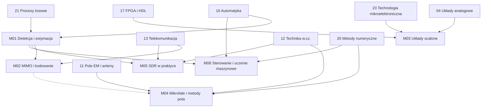

# Ścieżka magisterska (II stopień)

Rozszerzenie roadmapy o tematy, które na studiach EiT pojawiają się na drugim stopniu i w specjalnościach. Moduły zakładają przerobienie odpowiednich modułów inżynierskich (wymagania wstępne są podane w każdym module) i mają wyraźnie bardziej matematyczny charakter: wyprowadzenia, granice teoretyczne, algorytmy implementowane od zera w Pythonie i porównywane z teorią.

Układ każdego tematu jest taki sam jak w modułach inżynierskich: *Po co to jest*, *Teoria w pigułce*, *Przykład rozwiązany*, *Typowe pułapki*, *Ćwiczenie komputerowe* (kod sprawdzany automatycznie), *Zadania* z odpowiedziami i *Źródła*.

## Moduły

| # | Moduł | Odpowiednik na studiach | Czas | Status |
|---|---|---|---|---|
| M01 | [Detekcja, estymacja i filtracja optymalna](M01-estymacja-detekcja-filtracja/) | Statystyczne przetwarzanie sygnałów, Teoria estymacji, Filtracja adaptacyjna | ok. 80 h | ✅ pełny |
| M02 | [MIMO, kształtowanie wiązki i nowoczesne kodowanie](M02-mimo-i-kodowanie/) | Systemy wieloantenowe, Kodowanie kanałowe, Systemy 5G | ok. 70 h | ✅ pełny |
| M03 | [Projektowanie układów scalonych](M03-projektowanie-ukladow-scalonych/) | Projektowanie analogowych i cyfrowych układów scalonych, VLSI | ok. 80 h | ✅ pełny |
| M04 | [Technika mikrofalowa, szyki antenowe i numeryczne metody pola](M04-mikrofale-anteny-metody-pola/) | Technika mikrofalowa, Anteny i propagacja, Metody numeryczne elektromagnetyzmu | ok. 75 h | ✅ pełny |
| M05 | [Radio programowalne (SDR) w praktyce](M05-sdr-w-praktyce/) | Radiokomunikacja, Systemy radiowe definiowane programowo | ok. 75 h | ✅ pełny |
| M06 | [Sterowanie zaawansowane i uczenie maszynowe](M06-sterowanie-zaawansowane-i-uczenie-maszynowe/) | Sterowanie optymalne i odporne, Identyfikacja, Uczenie maszynowe | ok. 75 h | ✅ pełny |

## Kolejność i zależności

M01, M03 i M04 są niezależne i można je przerabiać równolegle; M02 korzysta z M01 (estymacja MMSE, detekcja), M05 — z M01 (wykrywanie preambuły) i modułu 13, M06 — z M01 (najmniejsze kwadraty, filtr Kalmana). M04 korzysta z [M02.04](M02-mimo-i-kodowanie/04-szyki-i-ksztaltowanie-wiazki.md) tylko w temacie o szykach (linia przerywana).

## Wspólne narzędzia

- Python z `numpy`, `scipy`, `matplotlib` — wszystkie ćwiczenia komputerowe.
- M02: opcjonalnie [NVIDIA Sionna](https://github.com/NVlabs/sionna) do symulacji łączy 5G.
- M03: kontener [IIC-OSIC-TOOLS](https://github.com/iic-jku/IIC-OSIC-TOOLS) z otwartymi narzędziami i PDK (xschem, ngspice, Magic, KLayout, Netgen, LibreLane, OpenROAD).
- M04: symulator FDTD [openEMS](https://openems.de), [scikit-rf](https://scikit-rf.readthedocs.io); do pomiarów — tani analizator wektorowy (np. NanoVNA).
- M05: [GNU Radio](https://wiki.gnuradio.org/index.php?title=GRC), biblioteki `pyadi-iio` (ADALM-Pluto) i `pyrtlsdr` (RTL-SDR); sprzęt: RTL-SDR (odbiór) lub ADALM-Pluto (nadawanie w pętli kablowej).
- M06: [python-control](https://python-control.readthedocs.io); opcjonalnie PyTorch do rozszerzeń z sieciami neuronowymi, [CMSIS-NN](https://github.com/ARM-software/CMSIS-NN) do wnioskowania int8 na Cortex-M.
