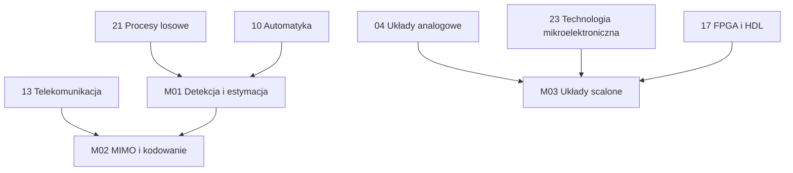

# Ścieżka magisterska (II stopień)

Rozszerzenie roadmapy o tematy, które na studiach EiT pojawiają się na drugim stopniu i w specjalnościach. Moduły zakładają przerobienie odpowiednich modułów inżynierskich (wymagania wstępne są podane w każdym module) i mają wyraźnie bardziej matematyczny charakter: wyprowadzenia, granice teoretyczne, algorytmy implementowane od zera w Pythonie i porównywane z teorią.

Układ każdego tematu jest taki sam jak w modułach inżynierskich: *Po co to jest*, *Teoria w pigułce*, *Przykład rozwiązany*, *Typowe pułapki*, *Ćwiczenie komputerowe* (kod sprawdzany automatycznie), *Zadania* z odpowiedziami i *Źródła*.

## Moduły

| # | Moduł | Odpowiednik na studiach | Czas | Status |
|---|---|---|---|---|
| M01 | [Detekcja, estymacja i filtracja optymalna](M01-estymacja-detekcja-filtracja/) | Statystyczne przetwarzanie sygnałów, Teoria estymacji, Filtracja adaptacyjna | ok. 80 h | ✅ pełny |
| M02 | [MIMO, kształtowanie wiązki i nowoczesne kodowanie](M02-mimo-i-kodowanie/) | Systemy wieloantenowe, Kodowanie kanałowe, Systemy 5G | ok. 70 h | ✅ pełny |
| M03 | [Projektowanie układów scalonych](M03-projektowanie-ukladow-scalonych/) | Projektowanie analogowych i cyfrowych układów scalonych, VLSI | ok. 80 h | ✅ pełny |
| M04 | Technika mikrofalowa, szyki antenowe i numeryczne metody pola | Technika mikrofalowa, Metody numeryczne elektromagnetyzmu | — | 🔜 planowany |
| M05 | Radio programowalne (SDR) w praktyce | Radiokomunikacja, Systemy SDR | — | 🔜 planowany |
| M06 | Sterowanie zaawansowane i uczenie maszynowe w przetwarzaniu sygnałów | Sterowanie optymalne i odporne, Uczenie maszynowe | — | 🔜 planowany |

## Kolejność i zależności

M01 i M03 są niezależne i można je przerabiać równolegle; M02 korzysta z M01 (estymacja MMSE, detekcja).

## Wspólne narzędzia

- Python z `numpy`, `scipy`, `matplotlib` — wszystkie ćwiczenia komputerowe.
- M02: opcjonalnie [NVIDIA Sionna](https://github.com/NVlabs/sionna) do symulacji łączy 5G.
- M03: kontener [IIC-OSIC-TOOLS](https://github.com/iic-jku/IIC-OSIC-TOOLS) z otwartymi narzędziami i PDK (xschem, ngspice, Magic, KLayout, Netgen, LibreLane, OpenROAD).
